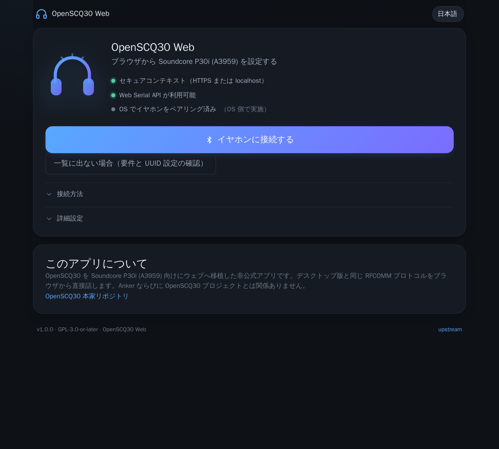
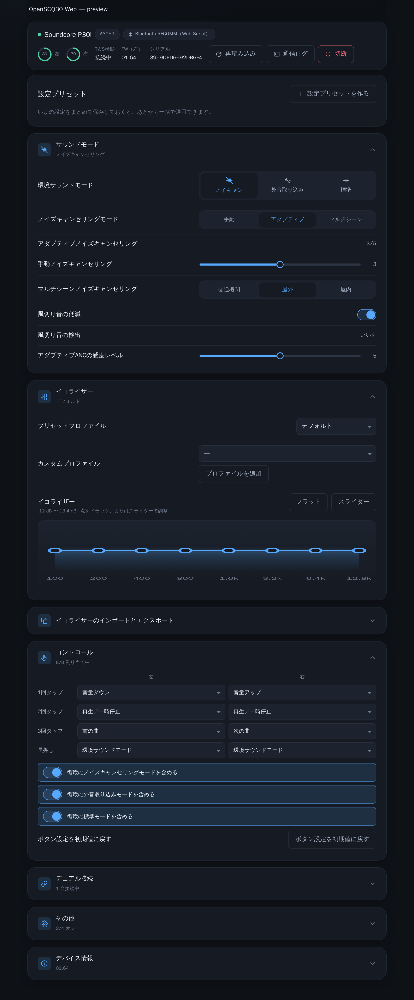
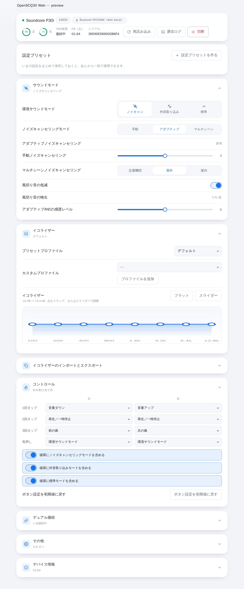
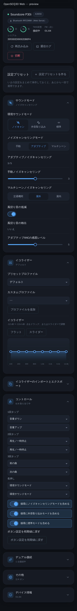
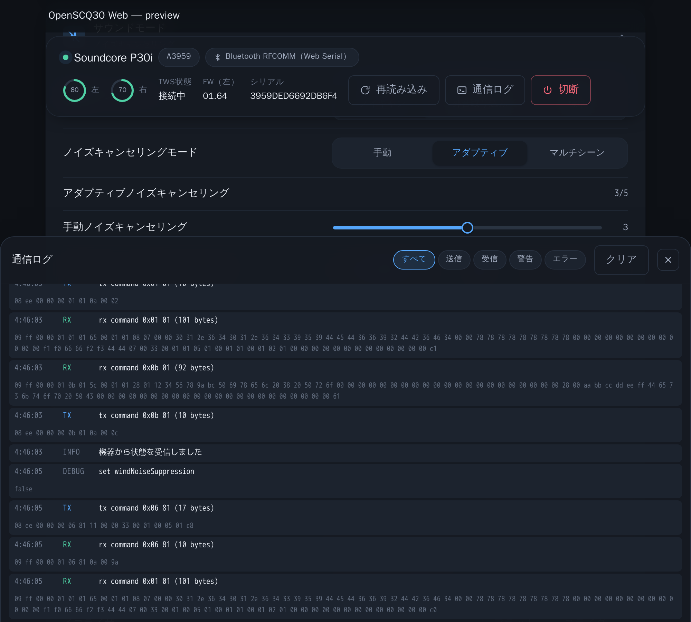

# OpenSCQ30 Web

[OpenSCQ30](https://github.com/Oppzippy/OpenSCQ30) を **ブラウザで動くウェブアプリ**に移植したものです（非公式）。
対象機種は **Soundcore P30i（型番 A3959）**。デスクトップ版と同じ RFCOMM プロトコルをブラウザから直接しゃべります。

Render の**静的サイト（無料枠）**にそのままデプロイできます。サーバーもデータベースも不要で、
設定値が外部に送信されることはありません（すべてブラウザ内完結）。

---

## なぜ Web Serial なのか（重要な前提）

OpenSCQ30 は BLE ではなく **Bluetooth Classic の RFCOMM（SPP / ベンダー UUID）** で機器と通信します。

| ブラウザ API | RFCOMM | 結論 |
| --- | --- | --- |
| Web Bluetooth | ✕（BLE/GATT のみ） | 使えない |
| **Web Serial** | **○**（Chrome 117+ デスクトップ / Chrome 138+ Android） | **これを採用** |

したがって本アプリの実機接続は次の環境でのみ動作します。

- **Chrome / Edge 117 以降**（Windows・macOS・Linux・ChromeOS）、または **Android の Chrome 138 以降**
- **HTTPS**（secure context）。Render の `*.onrender.com` は HTTPS なので条件を満たします
- 事前に **OS の Bluetooth 設定でペアリング済み**であること

Safari / Firefox / iOS では Web Serial が実装されていないため**実機接続はできません**。

## 機能

- **サウンドモード**: 環境サウンドモード（ノイズキャンセリング／外音取り込み／標準）、ANC モード（手動／アダプティブ／マルチシーン）、手動 ANC 強度、マルチシーン（交通機関／屋外／屋内）、風切り音低減、アダプティブ ANC 感度
- **イコライザー**: 22 種類のプリセット、8 バンドのカスタム調整（DRC 付きパケット生成）、カスタムプロファイルの保存、インポート／エクスポート（デスクトップ版と同じ JSON 形式）
- **コントロール**: 左右の 1/2/3 回タップ・長押しに割り当て、モード循環の入れ替え、初期値へのリセット
- **デュアル接続（マルチポイント）**: ON/OFF、接続するデバイスの選択・解除
- **その他**: サラウンドサウンド、オートパワーオフ、操作音、電池残量低下の通知音、ゲームモード（ファームウェア 01.60 以上）
- **デバイス情報**: バッテリー残量（左／右）・充電状態、TWS 状態、ホストデバイス、シリアル番号、ファームウェア
- **設定プリセット**: 現在の設定をまとめて保存し、一括で適用（ブラウザ内保存）
- **通信ログ**: 送受信パケットを 16 進で表示（実機トラブルシュート用）
- **日本語 / English** UI
- **PWA**: ホーム画面にインストール可能、初回アクセス後はオフラインでも起動（Service Worker）
- **選択ダイアログは対応機器のみ**: USB シリアルや他機種の SPP ポートは候補に出しません

## 見た目

| 接続画面 | 設定画面（ダーク） |
| --- | --- |
|  |  |

| ライトテーマ | モバイル | 通信ログ |
| --- | --- | --- |
|  |  |  |

UI の要点:

- **折り返しのない一画面の情報設計**: カテゴリはアコーディオンにし、閉じた状態でも
  「いま何になっているか」をサブタイトルに表示（例: `ノイキャン` / `8/8 割り当て中` / `1 台接続中`）
- **モード類はセグメントコントロール**（アイコン付き）、**イコライザーはドラッグ可能な応答カーブ**
  （アクセシビリティ用にスライダーも併設、`prefers-reduced-motion` 対応）
- **タッチ操作は 左×右 のマトリクス**、**デバイス情報はコンパクトなキー/バリュー表**で行数を削減
- **バッテリーはリング表示**、接続中はトップバーに不定プログレス、エラーは自動消滅するトースト
- **通信ログはボトムドロワー**（送信/受信/警告/エラーでフィルタ、16 進を表示）
- ダーク / ライト自動、依存 CSS ライブラリ・Web フォント不使用（バンドルは JS 81 KB gzip）

スクリーンショットの再生成: `npm run screenshots`（ヘッドレス Chromium が必要）

## まず試す

```bash
npm install
npm run dev        # http://localhost:5173
```

`http://localhost` は secure context 扱いなので、**デプロイしなくても実機の P30i に接続できます**。
OS でペアリングしてから「イヤホンに接続する」→ 一覧から Soundcore を選んでください。
実機がない環境では接続画面までが表示され、ブラウザ要件のチェック結果がその場に出ます。

> 開発者向け: 設定画面のデザイン確認用に、テストダブル（`tests/support/fakeDevice.ts`）を
> 繋ぐ**開発専用プレビュー**を同梱しています（`npm run build:preview` → `dist-preview/`）。
> これは CI・デプロイで使う `npm run build` には含まれず、公開ページから到達する方法もありません。

## 実機に接続する

1. OS の Bluetooth 設定で P30i をペアリングする
2. 本アプリを開き「**イヤホンに接続する**」を押す
3. ブラウザの選択ダイアログで Soundcore の項目（Bluetooth RFCOMM）を選ぶ
4. デスクトップ版 OpenSCQ30 や公式 Soundcore アプリとは**同時に接続しない**

選択ダイアログには**対応機器のサービスだけ**が表示されます。既定で候補になるのは
P30i の Soundcore ベンダー RFCOMM サービス（`0cf12d31-fac3-4553-bd80-d6832e7b3959`）のみで、
USB シリアル変換アダプタやプリンタ、他機種の SPP ポートは一覧に出ません。

一覧に Soundcore が出てこない場合:

- Chrome / Edge の最新版であること（`chrome://version`）
- HTTPS（または `localhost`）で開いていること
- 他のアプリ（公式アプリ、デスクトップ版 OpenSCQ30）が RFCOMM を掴んでいないこと
- 「詳細設定」→ **追加の Bluetooth サービス UUID** に、機器が出す UUID を追加する。
  Linux なら `bluetoothctl` + `sdptool browse <MAC>`、またはデスクトップ版 OpenSCQ30 を
  `--verbose` で起動してログから確認できます
- その機器が標準 SPP しか公開していない場合は「詳細設定」→
  **標準 SPP サービスも候補に含める** をオンにする（他種の SPP 機器も一覧に出るようになります）

## デプロイする

**デプロイしなくても実機で試せます**: `http://localhost` は secure context 扱いなので、
`npm run dev` → Chrome / Edge で `http://localhost:5173` を開けば、そのまま P30i に接続できます。

公開する場合、本アプリは静的ファイルだけなので HTTPS で配信できる場所ならどこでも動きます。

### Render（Blueprint を使わない方法も含む）

一番簡単なのは Dashboard からの手動作成です。

1. https://dashboard.render.com/ → **New +** → **Static Site** → リポジトリを選択
2. **Build Command**: `npm ci && npm run build` / **Publish Directory**: `dist`
3. 環境変数 `NODE_VERSION` = `20.17.0`
4. **Create Static Site** → `https://<name>.onrender.com`

Blueprint（`render.yaml` 同梱）、Deploy Hook による CI 連携、Render API / CLI での作成手順と
トラブルシュート表は **[docs/deploy-render.md](docs/deploy-render.md)** にまとめてあります。

### Render 以外

GitHub Pages（ワークフロー同梱）・Cloudflare Pages・Netlify・Vercel・自前 nginx・Docker の手順と、
サブパス配信時の `BASE_PATH` 指定は **[docs/deploy-other-platforms.md](docs/deploy-other-platforms.md)**。

```bash
npm ci && npm run build                 # -> dist/
BASE_PATH=/openscq30-web/ npm run build  # GitHub Pages のようなサブパス配信用
```

> **注意**: Web Serial はトップレベルの HTTPS ページでのみ使えます。iframe に埋め込む場合は
> 埋め込み側で `allow="serial"` が必要です（`render.yaml` の `Permissions-Policy` は self のみ許可）。

## PWA / オフライン

- `manifest.webmanifest` + 192/512 PNG（any / maskable）を同梱。Chrome / Edge / Android で
  **ホーム画面にインストール**できます
- `public/sw.js` はナビゲーションをネットワーク優先（オフライン時はキャッシュへフォールバック）、
  ハッシュ付きアセットをキャッシュ優先で扱います。デプロイごとに `scripts/finalize-sw.mjs` が
  キャッシュ名を更新し、古いキャッシュは activate 時に削除されます
- Service Worker は**本番ビルドでのみ**登録されます（開発サーバーは非干渉）
- アイコンの再生成: `npm run icons`（`public/favicon.svg` から PNG を生成）

## 公開前チェックリスト

公開（= 不特定の人に URL を渡す）前に、この順で確認してください。

1. `npm ci && npm test && npm run build && npm run smoke` が全て green
2. Render（または任意の HTTPS ホスト）にデプロイされ、`https://…` で開ける
3. **Chrome / Edge** で開き、接続画面に「イヤホンに接続する」と要件チェック（緑 2 つ）が出る
4. 実機を OS でペアリングし、「イヤホンに接続する」→ 候補に Soundcore が出る → 接続して
   バッテリー・シリアル・FW が表示される
5. EQ を 1 バンド動かして「通信ログ」に `02 83` の送信と ACK が出る
6. 端末を電源 OFF して、トースト「機器との接続が切れました。」が出ること
7. `npm run pwa-check` が green（SW 有効化・オフライン起動・オンライン復帰）
8. DevTools → Application → Manifest / Service Worker にエラーが無いこと（インストール可能）
9. `docs/deploy-render.md` のヘッダー（CSP / Cache-Control）が効いていること
   `curl -sI https://…/sw.js | grep -i cache-control` → `no-cache`

実機が手元に無い環境では 4〜6 の代わりに `npm run build:preview` のプレビューハーネスで
画面遷移を確認できます（公開ビルドには含まれません）。

## 開発

```bash
npm run dev        # 開発サーバー
npm test           # 51 件のユニット／統合テスト（vitest）
npm run build      # 型チェック + 本番ビルド（dist/）
npm run smoke      # ビルド後に jsdom で実際に操作する E2E スモークテスト
                   # （プロダクションバンドルにシミュレータが混入していないことも検証します）
npm run pwa-check  # 実ブラウザで SW 有効化・オフライン起動・復帰を検証
npm run icons      # favicon.svg から PWA 用 PNG を再生成
npx tsc --noEmit   # 型チェックのみ
```

テストは **openscq30-lib の実テストベクタ**（実機から採取された state update パケットと期待値、
DRC の期待出力、手作業で作成されたパケット列）をそのまま移植して照合しています。
例: `tests/a3959.test.ts` は `lib/src/devices/soundcore/a3959.rs` の
`test_with_packet_from_github_issue_149` などのパケットを使用しています。

### ディレクトリ構成

```
src/
  lib/            プロトコル共通層（openscq30-lib の common 相当）
    bytes.ts        ByteReader / チェックサム / ユーティリティ
    packet.ts       パケット framing（direction, command, length, checksum）
    packetIo.ts     再送・ACK 待ち・フラグメント再構成・非要求パケット配送
    migration.ts    サウンドモード遷移プランナー（BFS）
    settings.ts     UI 向け設定モデル（Setting / Value）
    structures/     バイト単位の構造体（battery, equalizer, buttons, ...）
  devices/a3959/  機種固有実装（state update, プリセット, ボタン定義, controller）
  transport/      webSerial.ts（実機のみ。シミュレータは tests/support/fakeDevice.ts にテスト専用で存在）
  session/        接続ライフサイクル、ログ、localStorage ストレージ
  i18n/           日本語 / 英語（ラベルは本家 fluent カタログ準拠）
  ui/             React コンポーネント
tests/            vitest
scripts/smoke.mjs ビルド済みバンドルを jsdom で操作するスモークテスト
```

### 別の機種を追加する

1. `src/devices/<model>/` を作り、`state.ts`（state update パケットの解析／生成）と
   `controller.ts`（設定の get/set と state modifier）を用意する
2. `src/devices/a3959/*` を雛形に、openscq30-lib の該当機種
   （`lib/src/devices/soundcore/a****.rs`）のフィールド順・コマンド・モジュール構成を写す
3. `src/lib/structures/` の共通構造体はそのまま再利用できます
4. 本家のテストにある実パケットを `tests/` に移植すると、実機なしで正確性を検証できます

プロトコルの詳細は [docs/protocol.md](docs/protocol.md)。

## 本家との差分（意図的な変更）

いずれもバグ調査中に見つかった「実機で困る挙動」を潰したものです。

- **ボタンリセット後の pending フラグ**: 本家は `button_reset_pending` を解除しないため、
  リセット後に再接続するまでボタン変更が効きません。本移植ではリセット完了後に解除します。
- **受信パース失敗時の再同期**: 本家はバッファを全破棄するため、同じチャンクに正常パケットが
  続いていたらそれも失います。本移植は 1 バイトずつずらして次のパケット先頭を探します
  （`tests/bugs.test.ts` の 5000 バイトのランダムデータ注入で検証）。
- **異常な長さフィールドの拒否**: 長さフィールドが 8192 を超える（＝ゴミデータ）場合は
  「不完全」ではなくエラー扱いにし、受信バッファが無限に増えるのを防ぎます。
- **切断検知**: RFCOMM の可読ストリームが正常終了した場合（電源 OFF、圏外、他アプリによる
  占有）も切断として UI に通知します。`disconnect` イベントだけに頼ると取りこぼします。
- **接続直後のパケット**: ポートを開いてから読みハンドラが登録されるまでに届いたバイトを
  破棄せず保持します。
- **切断時の保留リクエスト**: 設定適用中に切断された場合、プロミスが永久に未解決になって
  UI が「適用中…」のまま固まる不具合を修正（`connection closed` で reject）。
- **ファームウェア解析の寛容化**: 左右ともファームウェアが欠落しているパケットでは、本家は
  パースエラーで接続に失敗しますが、本移植は「不明」として接続を継続します。
- **状態更新パケットのパース失敗時**: エラーメッセージに body の 16 進を添えるので、
  未知のファームウェアに当たってもそのまま issue に貼れます。
- **UI**: libcosmic(iced) ではなく React。設定モデル（Setting/Value）は本家の API 形状に
  合わせているので、他機種の追加が容易です。

## ライセンスと帰属

GPL-3.0-or-later（本家 OpenSCQ30 と同じ）。
プロトコル実装は [OpenSCQ30](https://github.com/Oppzippy/OpenSCQ30)（Kyle Scheuing 氏、GPL-3.0-or-later）からの移植です。
日本語ラベルは本家の `lib/i18n/ja` / `gui/i18n/ja` を利用し、未訳分を補完しています。

本プロジェクトは Anker / Soundcore ならびに OpenSCQ30 プロジェクトとは関係ありません。
